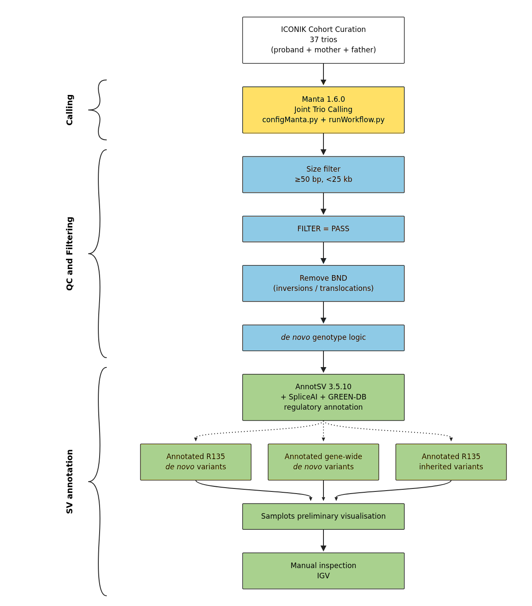

# ICONIK SV Analysis

De novo and inherited structural variant (SV) calling on whole-genome
sequencing trios, screened against the R135 paediatric cardiomyopathy gene
panel (PanelApp panel 749).



## Pipeline

Four stages, run in order:

1. **`scripts/SV_script/calling/`** - Manta joint SV calling per trio, plus
   de novo scoring (`denovo_scoring.py`).
2. **`scripts/SV_script/qc/`** - tier-1 filtering (PASS, no BND, 50bp-25kb,
   proband carries it), sex-aware de novo/inherited classification, then
   AnnotSV + SpliceAI + GREEN-DB annotation against the R135 panel and
   genome-wide.
3. **`scripts/SV_script/workbook_construction/`** - assembles the per-family
   TSVs from stage 2 into the final Excel workbooks (de novo, inherited,
   genome-wide, cross-family recurrence, proband/sibling comparison),
   written to `results/workbooks/`.
4. **`scripts/figure_scripts/samplots/`** - samplot trio images and HTML
   galleries for every candidate SV.

`scripts/figure_scripts/violin_plots/` is a standalone figure script (SV
size distribution, not part of the main pipeline run order).

Each stage's `.sh`/`.pbs` entry point is a standalone PBS job script.

## Dependencies

Not vendored here - install separately and point the scripts at your own
copies (edit the hardcoded paths near the top of each `.sh`):

- [Manta 1.6.0](https://github.com/Illumina/manta) (official binary release;
  used instead of a conda build, which SIGSEGVs on this dataset)
- [AnnotSV 3.5.10](https://github.com/lgmgeo/AnnotSV)
- [GREEN-VARAN](https://github.com/edg1983/GREEN-VARAN) + the GRCh38
  GREEN-DB BED ([Zenodo record 5636209](https://zenodo.org/record/5636209))
- [SpliceAI](https://github.com/Illumina/SpliceAI) (own conda env: python
  3.9 + tensorflow-cpu)
- [samplot](https://github.com/ryanlayer/samplot) (own conda env)
- BCFtools, BEDTools, SAMtools, BWA
- R packages: optparse, readr, dplyr, stringr, openxlsx, data.table,
  ggplot2, scales, patchwork

## Reference

Not vendored here (the fasta + BWA index alone are ~8GB). Run:

```
scripts/setup_reference.sh
```

This downloads the GRCh38 DRAGEN masked reference (Broad's
`Homo_sapiens_assembly38_masked.fasta`, public - no auth needed) and builds
`.fai`/`.dict`/BWA index into `reference/`.

## Data and results

Raw data (CRAMs, pedigree, diagnosis records) is not included - see
`data/README.md`. Three exceptions are included as example/final output:

- `results/workbooks/` - the 7 final Excel workbooks this pipeline
  produces (de novo R135, inherited R135, genome-wide/allgenes,
  cross-family overlap, and 3 proband/sibling comparison workbooks).
  These carry real per-family sample IDs, genes, and clinical annotations,
  but no file/server paths.
- `figures/sv_violin_distributions/` - two aggregate, cohort-level SV size
  distribution plots (raw vs tier1-filtered, de novo vs inherited) from
  `scripts/figure_scripts/violin_plots/sv_size_violin.R`.
- `figures/visualisations/` - three worked-example samplot/IGV candidate
  figures (TTN, MAP2K2, PABPC1 tandem duplications/deletion), reproduced
  from the author's dissertation.
